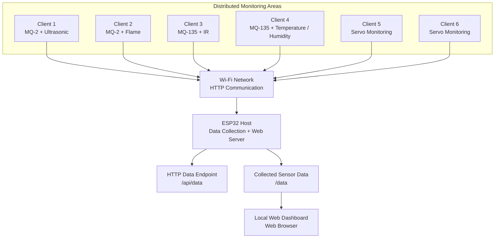

# NEXUS-6
### Distributed Multi-Room Sensor Monitoring Network Using ESP32

**A modular IoT-based monitoring system designed to collect sensor data from six distributed ESP32 client nodes and centralize it through a single ESP32 host with a local web dashboard.**

<p align="center">
  
  
  
  
  
</p>

<p align="center">
  <strong>One Host · Six Client Nodes · Centralized Monitoring</strong>
</p>

---

## Overview

NEXUS-6 is a distributed sensor-monitoring project built around the ESP32 microcontroller platform. It is designed to monitor multiple rooms or designated areas through independent sensor nodes while providing a centralized interface for viewing their reported data.

Instead of connecting every sensor directly to a single controller, the system distributes sensing tasks across multiple ESP32 clients. Each client reads its assigned sensors and transmits its readings over Wi-Fi to a central ESP32 host. The host processes the incoming HTTP requests and provides a local web dashboard for monitoring the connected nodes.

The architecture separates sensor acquisition from centralized monitoring, making the system easier to organize, troubleshoot, extend, and maintain.

### Core Concept

- **Distributed sensing:** Independent ESP32 clients handle sensors in different rooms or areas.
- **Centralized collection:** A single ESP32 host receives data from the client nodes.
- **Network communication:** Clients communicate with the host using Wi-Fi and HTTP.
- **Local visualization:** A browser-based dashboard presents the collected information.
- **Modular design:** Sensor configurations and client firmware can be maintained separately.

> **Project objective:** Develop a structured, modular, and extensible multi-node monitoring system using affordable embedded hardware and standard networking protocols.

---

## Table of Contents

- [System Architecture](#system-architecture)
- [Key Features](#key-features)
- [Hardware Architecture](#hardware-architecture)
- [Planned Client Configuration](#planned-client-configuration)
- [Technology Stack](#technology-stack)
- [Communication Workflow](#communication-workflow)
- [Repository Structure](#repository-structure)
- [Getting Started](#getting-started)
- [Host Configuration](#host-configuration)
- [Client Configuration](#client-configuration)
- [Accessing the Dashboard](#accessing-the-dashboard)
- [Testing and Validation](#testing-and-validation)
- [Safety and Security](#safety-and-security)
- [Current Development Status](#current-development-status)
- [Limitations](#limitations)
- [Future Development](#future-development)
- [Contributing](#contributing)
- [Author](#author)
- [License](#license)

---

## System Architecture

NEXUS-6 follows a centralized host-client architecture. Each client operates as an independent sensor node, while the host provides the common data collection and visualization interface.



*The client assignments shown above represent the intended project configuration. Actual sensor support and data fields depend on the firmware implemented for each node.*

### Architectural Components

| Component | Responsibility |
|---|---|
| ESP32 Host | Receives client data and serves the monitoring interface |
| ESP32 Client Nodes | Read assigned sensors and transmit readings |
| Wi-Fi Network | Provides network connectivity between clients and host |
| HTTP API | Transfers client readings to the host |
| Data Endpoint | Exposes collected data for dashboard consumption |
| Web Dashboard | Displays available monitoring information in a browser |

### Why a Distributed Architecture?

A distributed approach provides several engineering advantages:

- Sensor connections are distributed across multiple nodes.
- Each client can be developed and debugged independently.
- Additional sensing locations can be introduced through new client nodes.
- Hardware-specific changes can be isolated to the relevant client.
- Centralized monitoring simplifies the overall user interface.

These advantages depend on reliable network connectivity, consistent message formats, and suitable error-handling mechanisms.

---

## Key Features

### 1. Multi-Node Monitoring

The system is designed around one host and six ESP32 client nodes. Each client is assigned a unique identifier so the host can associate incoming data with the appropriate node.

### 2. Centralized Data Collection

Clients send sensor readings to a common host endpoint instead of requiring separate dashboards for individual nodes.

### 3. Wi-Fi and HTTP Communication

Standard HTTP requests provide a straightforward method for transferring structured sensor readings over a local Wi-Fi network.

### 4. Browser-Based Monitoring

The host is designed to serve a web interface that can be accessed from a compatible browser on the same network.

### 5. Modular Firmware Organization

Host firmware and client firmware are maintained separately, allowing individual nodes to be developed and tested without mixing all logic into one source file.

### 6. Extensible Sensor Integration

The architecture can accommodate additional sensor types when the corresponding hardware, firmware fields, host-side processing, and dashboard components are implemented.

### 7. Documentation-First Development

Hardware connections, network configuration, sensor assignments, and testing procedures can be documented independently for easier maintenance and reproducibility.

---

## Hardware Architecture

The primary hardware platform is the ESP32 family of microcontrollers.

### Core Hardware

| Hardware | Purpose |
|---|---|
| ESP32 development boards | Host and client controllers |
| Sensor modules | Environmental and proximity measurements |
| Wi-Fi-capable network | Communication between the nodes |
| USB data cables | Firmware uploading, serial debugging, and power |
| Breadboards and jumper wires | Prototyping and sensor connections |
| Compatible power supplies | Powering the ESP32 boards and peripherals |

### Sensor Categories

The planned configuration includes:

- Gas and air-quality-related sensing
- Flame detection
- Infrared detection
- Ultrasonic distance measurement
- Temperature and humidity measurement
- Servo-related status or position monitoring

Sensor availability and output formats vary by module. Analog, digital, I²C, and other interfaces must be configured according to the actual hardware.

---

## Planned Client Configuration

The following table describes the intended allocation of monitoring functions.

| Node | Planned sensor or device configuration | Monitoring purpose |
|---|---|---|
| Client 1 | MQ-2 + HC-SR04 | Gas-related sensing and distance measurement |
| Client 2 | MQ-2 + Flame Sensor | Gas-related sensing and flame detection |
| Client 3 | MQ-135 + IR Sensor | Air-quality-related sensing and IR detection |
| Client 4 | MQ-135 + Temperature/Humidity Sensor | Air-quality-related and environmental measurements |
| Client 5 | Servo | Servo-related status or position monitoring |
| Client 6 | Servo | Servo-related status or position monitoring |

**Important:** The table documents the intended design, not a claim that all six clients have been completed or validated. Servo position feedback also requires suitable position sensing or an explicitly defined estimate; a commanded servo angle alone does not verify the physical position.

---

## Technology Stack

| Technology | Role |
|---|---|
| ESP32 | Embedded controller and Wi-Fi connectivity |
| Arduino Framework | Firmware development |
| C/C++ | Embedded application logic |
| Wi-Fi | Network transport |
| HTTP | Client-to-host data communication |
| JSON | Structured sensor-data exchange |
| Arduino `WebServer` | Host-side web server |
| Arduino `HTTPClient` | Client-side HTTP requests |
| ArduinoJson | JSON serialization and parsing |
| HTML, CSS, JavaScript | Browser dashboard interface |
| Git and GitHub | Version control and project documentation |

Library names describe the intended implementation stack. The exact versions and dependencies should be recorded alongside the firmware as the project develops.

---

## Communication Workflow

The expected data flow is:

1. A client initializes its configured sensors and Wi-Fi connection.
2. The client reads sensor values at a defined sampling interval.
3. The client packages the readings into a structured JSON message.
4. The client sends an HTTP POST request to the host's `/api/data` endpoint.
5. The host validates the request and associates the data with the client identifier.
6. The host updates the stored monitoring data.
7. The browser dashboard requests the available data and displays the reported values.

```text
Sensors
   |
   v
ESP32 Client
   |
   | Read + Format JSON
   v
HTTP POST Request
   |
   v
ESP32 Host
   |
   | Validate + Store
   v
Central Data Endpoint
   |
   v
Browser Dashboard
```

### Example JSON Message

The following is an illustrative payload. Actual field names must match the implemented firmware.

```json
{
  "client_id": 1,
  "mq2_value": 0,
  "ultrasonic_cm": 125.4
}
```

Here, `client_id` identifies the node, while the other fields represent example sensor readings. A value of `0` is only an example and must not be interpreted as a universal sensor-safe state.

### Expected Endpoints

| Endpoint | Method | Intended purpose |
|---|---|---|
| `/` | GET | Serve the dashboard |
| `/api/data` | POST | Receive client sensor data |
| `/data` | GET | Return collected data for the dashboard |

These endpoints must be implemented in the host firmware before they can be relied upon.

---

## Repository Structure

The repository is organized to separate host firmware, client firmware, documentation, and visual assets.

```text
NEXUS-6/
├── README.md
├── Host/
│   └── Host_HTTP_6_Clients.ino
├── Clients/
│   ├── Client_1/
│   ├── Client_2/
│   ├── Client_3/
│   ├── Client_4/
│   ├── Client_5/
│   └── Client_6/
├── Documentation/
│   ├── Hardware/
│   ├── Network_Architecture/
│   └── Sensor_Details/
└── Images/
```

The tree illustrates the intended repository layout. Firmware files, diagrams, and supporting documents should be added as they are created and validated.

### Directory Responsibilities

- `Host/` — Central ESP32 host firmware.
- `Clients/Client_1/` through `Client_6/` — Independent client firmware and node-specific configuration.
- `Documentation/Hardware/` — Wiring diagrams, pin assignments, and hardware notes.
- `Documentation/Network_Architecture/` — Network topology and communication specifications.
- `Documentation/Sensor_Details/` — Sensor specifications, interfaces, and data interpretation.
- `Images/` — Dashboard screenshots, architecture figures, and project photographs.

---

## Getting Started

### Prerequisites

Before compiling the firmware, prepare:

- ESP32 development boards with suitable USB data cables.
- Arduino IDE or a compatible ESP32 development environment.
- ESP32 board support for the selected development environment.
- The libraries required by the selected firmware.
- A Wi-Fi network accessible to the host and clients.
- The required sensor modules and correctly wired connections.

### 1. Clone the Repository

```bash
git clone https://github.com/Mr-Manish-Pal/NEXUS-6.git
cd NEXUS-6
```

### 2. Open the Host Firmware

Open the host `.ino` file from the `Host/` directory in Arduino IDE.

The filename shown in the repository structure is a proposed filename. It must exist in the repository before it can be opened.

### 3. Configure the Host

Set the network configuration and verify the host's API handlers, data storage, and dashboard routes.

### 4. Configure Each Client

Open the firmware for the required client, configure its Wi-Fi credentials and host address, and verify the GPIO assignments against the physical wiring.

### 5. Upload and Test

Upload the host firmware first. Once the host starts and its network address is known, configure and upload the client firmware.

Test each node individually before testing all six together.

---

## Host Configuration

The host is responsible for receiving HTTP requests and making collected data available to the dashboard.

### Example Host Address

During development, the host address has been identified as:

```text
http://10.108.178.84
```

This is a development address, not a permanent public URL. It may change when the ESP32 reconnects or receives a different DHCP lease.

### Example API URL

```text
http://10.108.178.84/api/data
```

Use the actual IP address reported by the host at runtime. The host and clients must have network connectivity, and the configured routes must match the firmware.

### Host Responsibilities

- Initialize the Wi-Fi connection.
- Start the HTTP web server.
- Receive and validate incoming client messages.
- Associate messages with the correct client identifier.
- Maintain the data required by the dashboard.
- Serve the dashboard and data endpoint.
- Report connection or request failures through appropriate debugging output.

---

## Client Configuration

Each client should maintain its own sensor initialization, sampling logic, and transmission configuration.

### Example Client Settings

```cpp
#define CLIENT_ID 1

const char* WIFI_SSID = "YOUR_WIFI_SSID";
const char* WIFI_PASSWORD = "YOUR_WIFI_PASSWORD";

const char* HOST_API_URL =
    "http://YOUR_HOST_IP/api/data";
```

These are configuration examples, not a complete firmware implementation.

Replace the placeholders with the appropriate local configuration. Do not commit real Wi-Fi passwords, API secrets, or other private credentials to a public repository.

### Client Development Checklist

- [ ] Assign a unique client ID.
- [ ] Verify sensor wiring and GPIO assignments.
- [ ] Initialize the required sensors.
- [ ] Read and validate sensor values.
- [ ] Establish Wi-Fi connectivity.
- [ ] Format the payload according to the host's schema.
- [ ] Send the HTTP request to the correct endpoint.
- [ ] Handle timeouts and failed requests.
- [ ] Verify that the host receives the expected data.

---

## Accessing the Dashboard

After the host firmware has been uploaded and its web server is running:

1. Connect the monitoring computer or phone to the same reachable network.
2. Obtain the host's current IP address from its serial output or network configuration.
3. Open the host IP address in a web browser.

Example:

```text
http://10.108.178.84
```

The dashboard will be available only if the host firmware implements the root route and the browser can reach the host.

### Data Endpoint

For a direct response check, open:

```text
http://10.108.178.84/data
```

The endpoint is intended to return collected data in JSON format. The exact response depends on the implemented host firmware.

---

## Testing and Validation

A multi-node monitoring system must be tested at both the individual-node and system levels.

### Individual Node Tests

- Confirm that each sensor produces plausible readings.
- Verify the selected GPIO pins and electrical connections.
- Confirm that the client connects to the intended Wi-Fi network.
- Check HTTP response codes and transmission failures.
- Verify that the host associates each payload with the correct client ID.

### Integration Tests

- Verify that multiple clients can report data without corrupting one another's records.
- Confirm that the dashboard displays data from the correct nodes.
- Test behavior when a client disconnects or stops transmitting.
- Verify handling of malformed JSON and unexpected field values.
- Observe host stability during repeated requests.

### Reliability Tests

- Test repeated reconnects after temporary network interruptions.
- Check memory use during prolonged operation.
- Verify request timeouts and error reporting.
- Confirm that stale sensor values can be distinguished from fresh readings.

These are recommended validation procedures. Test results should be documented after the corresponding tests have actually been performed.

---

## Safety and Security

NEXUS-6 is intended as an embedded monitoring and learning platform. It should not be treated as a certified life-safety, fire-alarm, industrial-control, or gas-detection system.

### Electrical Safety

- ESP32 GPIO pins operate at 3.3 V logic levels.
- Do not connect a 5 V sensor output directly to an ESP32 GPIO unless the interface is explicitly 3.3 V-compatible.
- Use an appropriate voltage divider or level shifter for an HC-SR04 echo signal where required.
- Verify the supply voltage and current requirements of each sensor module.
- Provide suitable power arrangements for servos and other current-demanding peripherals.
- Ensure a common ground when required by the circuit design.

### Network Security

- Avoid committing Wi-Fi credentials to GitHub.
- Use an isolated or trusted network during development.
- Treat unauthenticated HTTP endpoints as untrusted.
- Do not expose the host directly to the public internet without an appropriate security design.
- Validate incoming client IDs, payload sizes, data types, and request contents.

### Sensor Limitations

Low-cost sensor modules may require calibration and can produce false positives or false negatives. Their readings must not be interpreted as certified measurements without appropriate validation.

---

## Current Development Status

NEXUS-6 is being developed as a modular ESP32 monitoring project.

| Area | Status |
|---|---|
| GitHub repository | Created |
| README and folder structure | Established |
| Host firmware | To be added or verified |
| Client firmware for six nodes | To be added or verified |
| Sensor wiring documentation | Planned |
| Network architecture documentation | Planned |
| Dashboard integration testing | To be verified |
| Six-node reliability testing | To be verified |

The status should be updated as implementation and testing progress. A repository structure alone does not establish that the corresponding firmware or functionality is complete.

---

## Limitations

The system's actual performance depends on Wi-Fi quality, request timing, sensor characteristics, host implementation, and the number of clients transmitting concurrently.

Potential limitations include:

- Network interruptions and dropped requests.
- Delays between sensor sampling and dashboard updates.
- Stale values when a client disconnects.
- Sensor calibration requirements.
- Shared-network interference and HTTP request contention.
- Limited authentication and transport security if plain HTTP is used.

These limitations should be measured and addressed as part of system validation rather than assumed to be resolved by the architecture.

---

## Future Development

Potential improvements for later versions include:

- **Node health monitoring:** Track client connectivity and last-seen timestamps.
- **Stale-data detection:** Distinguish unavailable readings from valid sensor values.
- **Robust error handling:** Add bounded retries, timeouts, and recovery behavior.
- **Sensor calibration:** Document calibration methods and sensor-specific thresholds.
- **Historical logging:** Store readings for trend analysis.
- **Data visualization:** Add time-series graphs and room-level summaries.
- **Configurable sampling:** Allow sensor sampling and transmission intervals to be adjusted.
- **Security enhancements:** Introduce authentication and appropriate network protections.
- **Scalable architecture:** Evaluate additional nodes and alternative messaging protocols when justified by measured requirements.
- **Automated testing:** Validate JSON schemas, endpoint behavior, and client identification.

Future features are proposals, not claims about the current implementation.

---

## Contributing

Contributions that improve reliability, maintainability, documentation, or sensor integration are welcome.

Suggested contribution workflow:

1. Fork the repository.
2. Create a dedicated branch for the proposed change.
3. Keep changes focused and document hardware dependencies.
4. Test firmware changes on the relevant hardware where possible.
5. Submit a pull request describing the change and its validation.

Hardware-specific contributions should include the relevant board, sensor module, GPIO assignments, power requirements, and testing notes.

---

## Author

**Manish Pal**

Embedded Systems and Electronics Engineering

Interested in ESP32 development, microcontrollers, sensor integration, embedded networking, and practical IoT engineering.

- **GitHub:** [@Mr-Manish-Pal](https://github.com/Mr-Manish-Pal)
- **Project Repository:** [NEXUS-6](https://github.com/Mr-Manish-Pal/NEXUS-6)

---

## License

A license has not yet been specified for this repository.

Before choosing one, decide how you want others to use, modify, and redistribute the project. If you want to make the code open source, add an appropriate license file and update this section accordingly.

---

<p align="center">
  <strong>NEXUS-6</strong><br/>
  Distributed Sensing. Centralized Monitoring. Modular Embedded Engineering.
</p>
